

    

I teach AI and machine learning, build interactive learning tools for my students, and spent four years in industry as a technical and freelance consultant, turning data into models, dashboards and decisions.

## ✨ Right now

- 🏫 Teaching **AI, ML, deep learning and computer vision** at SNMIMT Engineering College, Ernakulam
- 🧭 Supervising student projects, dissertations and internships
- 🛠️ Building interactive learning portals for KTU courses, from 3D networking labs to exam solvers
- 🔬 Exploring **RAG, AI agents and LLM evaluation**, and bringing them into the classroom
- 🤝 Open to research collaborations and consulting in intelligent systems

## 🚀 Featured projects

Each number carries its status: *Verified* means a committed, dated run in the repo; *Reported* means taken from a paper and not reproduced.

<table>
<tr><td width="50%" valign="top"><a href="https://janeferdinant.github.io/anomaly-detection-monitoring/">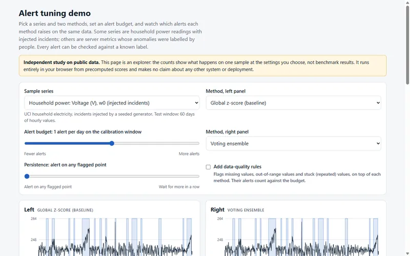</a> <b>Anomaly detection for monitoring</b> On injected anomalies, false alerts fall 77% against a z-score at matched recall; on real expert-labelled data no detector is distinguishable from it. <em>Verified, run 2026-10-14.</em> <a href="https://github.com/Janeferdinant/anomaly-detection-monitoring">Code</a> · <a href="https://janeferdinant.github.io/anomaly-detection-monitoring/">Live demo</a></td><td width="50%" valign="top"><a href="https://janeferdinant.github.io/ecommerce-recommender/">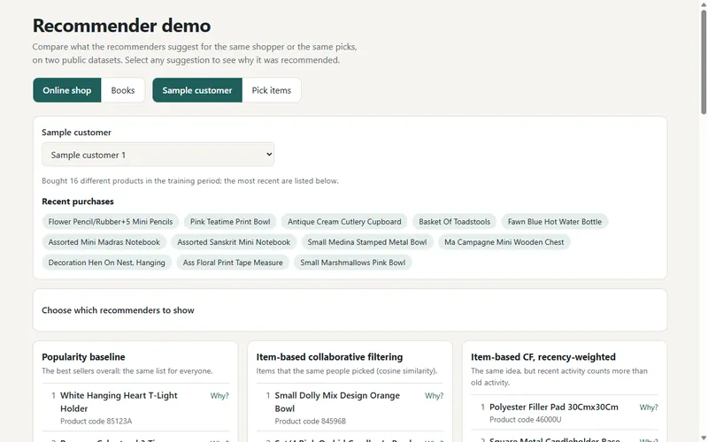</a> <b>E-commerce recommender</b> EASE reaches hit rate@10 of 46.1% on Online Retail II, +60.2% over popularity. Offline measurement, not live sales. <em>Verified, run 2026-10-14.</em> <a href="https://github.com/Janeferdinant/ecommerce-recommender">Code</a> · <a href="https://janeferdinant.github.io/ecommerce-recommender/">Live demo</a></td></tr>
<tr><td width="50%" valign="top"><a href="https://janeferdinant.github.io/transfer-learning-vision/">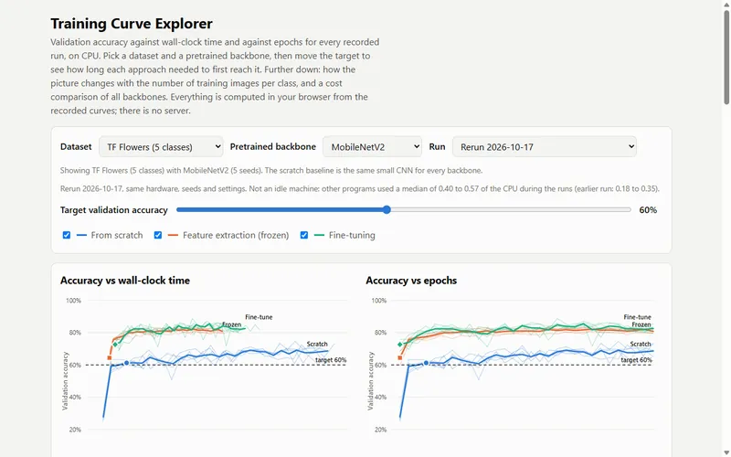</a> <b>Transfer learning for vision</b> MobileNetV2 reaches the target accuracy in 60% to 76% less CPU training time than a scratch CNN. <em>Verified, two committed runs, 2026-10-14 to 17.</em> <a href="https://github.com/Janeferdinant/transfer-learning-vision">Code</a> · <a href="https://janeferdinant.github.io/transfer-learning-vision/">Live demo</a></td><td width="50%" valign="top"><a href="https://janeferdinant.github.io/pneumonia-xray-cnn/">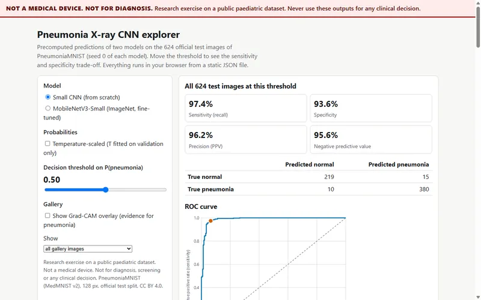</a> <b>Pneumonia X-ray CNN</b> Test AUC 0.986 for a small CNN against 0.928 for a pixel logistic-regression baseline on PneumoniaMNIST. A research exercise, not a diagnostic tool. <em>Verified, 5 seeds, run 2026-10-15.</em> <a href="https://github.com/Janeferdinant/pneumonia-xray-cnn">Code</a> · <a href="https://janeferdinant.github.io/pneumonia-xray-cnn/">Live demo</a></td></tr>
<tr><td width="50%" valign="top"><a href="https://janeferdinant.github.io/rag-document-qa-eval/">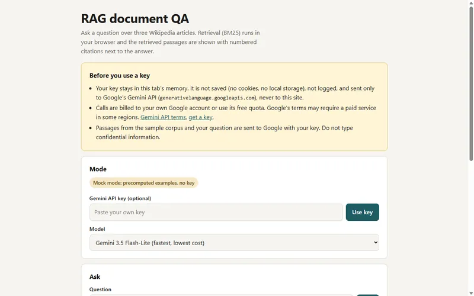</a> <b>RAG document QA evaluation</b> Hybrid retrieval with reranking reaches Recall@5 of 0.973 on held-out SQuAD 2.0 questions. <em>Verified, run 2026-10-15.</em> <a href="https://github.com/Janeferdinant/rag-document-qa-eval">Code</a> · <a href="https://janeferdinant.github.io/rag-document-qa-eval/">Live demo</a></td><td width="50%" valign="top"><a href="https://janeferdinant.github.io/loan-credit-risk-prediction/">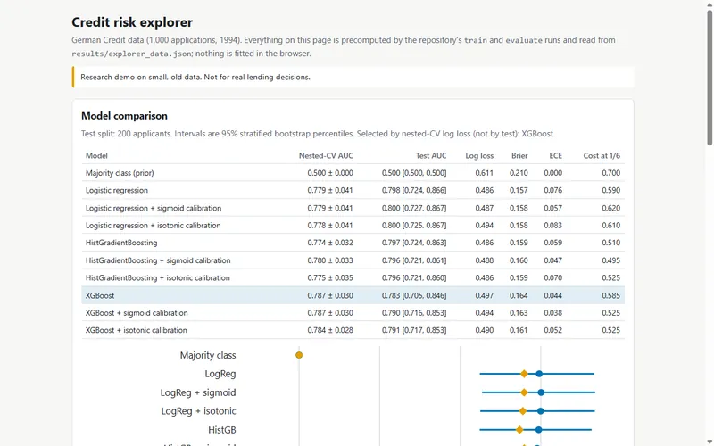</a> <b>Loan credit-risk prediction</b> On German Credit no model beats logistic regression reliably (AUC 0.798); the cost-based threshold costs 0.520 per applicant against 0.700 for rejecting everyone. <em>Verified, run 2026-10-15.</em> <a href="https://github.com/Janeferdinant/loan-credit-risk-prediction">Code</a> · <a href="https://janeferdinant.github.io/loan-credit-risk-prediction/">Live demo</a></td></tr>
<tr><td width="50%" valign="top"><a href="https://janeferdinant.github.io/analytics-dashboards/">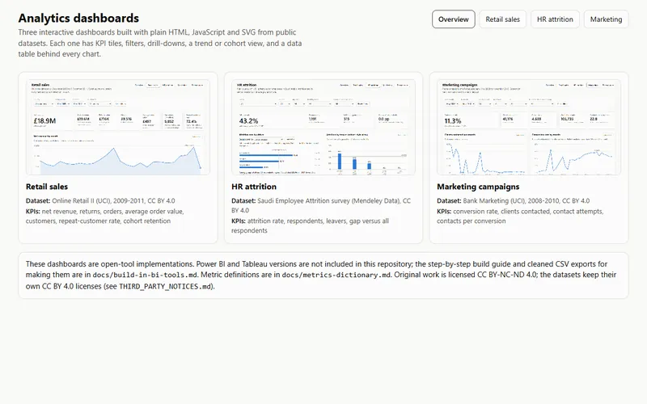</a> <b>Analytics dashboards</b> Retail, HR and marketing dashboards on public data; 33 of 33 data-quality checks pass. <em>Verified, run 2026-10-15.</em> <a href="https://github.com/Janeferdinant/analytics-dashboards">Code</a> · <a href="https://janeferdinant.github.io/analytics-dashboards/">Live demo</a></td><td width="50%" valign="top"><a href="https://janeferdinant.github.io/black-pepper-recognition/">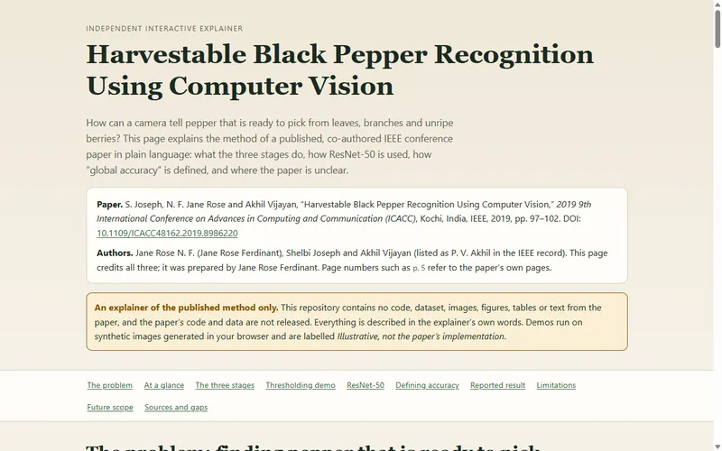</a> <b>Black pepper recognition</b> An explainer of my co-authored IEEE paper, which reports 100% global accuracy on 115 test images. <em>Reported in the paper, not reproduced here.</em> <a href="https://github.com/Janeferdinant/black-pepper-recognition">Code</a> · <a href="https://janeferdinant.github.io/black-pepper-recognition/">Live demo</a></td></tr>
</table>

**More projects:** [SMS spam (NLP)](https://github.com/Janeferdinant/NLP) · [Face-mask detection](https://github.com/Janeferdinant/FACEMASK_MTCNN) · [FX and Treasury forecasting (LSTM, DQN)](https://github.com/Janeferdinant/fx-treasury-forecasting-lstm-rl) · [Model serving with FastAPI](https://github.com/Janeferdinant/ml-model-serving-fastapi) · [Housing price regression](https://github.com/Janeferdinant/housing-price-regression)

## 🎓 Teaching tools

[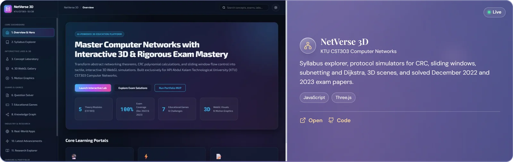](https://cst303-computer-networks-dashboard.vercel.app)

[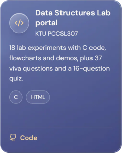](https://dsa-neon-kappa.vercel.app)   [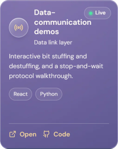](https://janeferdinant.github.io/bit/) [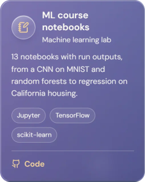](https://github.com/Janeferdinant/Machine-learning-Course) [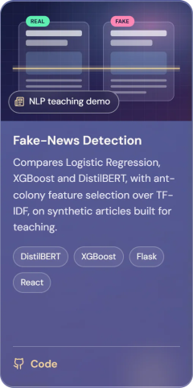](https://github.com/Janeferdinant/news)

*Each card opens the live tool where there is one, otherwise the code.*

## 🧰 Tech I work with

| Area | Tools and methods |
|---|---|
| 🤖 Generative AI & LLMs | LLM APIs (Gemini, OpenAI, Anthropic), prompt engineering, retrieval-augmented generation, embeddings and reranking, Hugging Face Transformers, structured outputs |
| 🧠 Machine & deep learning | Supervised and unsupervised learning, deep learning, NLP, time-series forecasting, anomaly detection, recommendation systems, reinforcement learning, explainable AI (SHAP), Optuna, scikit-learn, XGBoost, PyTorch, TensorFlow, Keras |
| 👁️ Computer vision | Image processing, face detection (MTCNN), transfer learning, CNNs, OpenCV |
| 📊 Data science & BI | Pandas, NumPy, SciPy, Matplotlib, Seaborn, Plotly, EDA, statistical analysis, data visualisation |
| 🗄️ Data engineering | SQL, ETL / ELT pipelines, data modelling, pipeline automation |
| ☁️ MLOps & cloud | MLflow, Docker, Git and GitHub, CI/CD with GitHub Actions, FastAPI, Flask, REST APIs, model serving and monitoring |
| 💻 Programming | Python, SQL, C / C++, MATLAB, JavaScript / TypeScript, React, Next.js, Pydantic, Pytest, Linux, software testing |
| 🔬 Research | Experimental design, statistical evaluation, benchmarking, ablation studies, reproducible experiments, literature review and research-gap analysis |
| 🌐 Web & visualisation | React, Next.js, Three.js, interactive data visualisation, 3D visualisation, interactive simulations |
| 📚 Familiar with | LangChain, LlamaIndex, vector databases, LLM fine-tuning (LoRA / PEFT), AI agents, LLM evaluation, LIME, YOLO, U-Net / SAM, ViT / CLIP, ONNX Runtime, TensorFlow Lite, Dash, Streamlit, DVC, Power BI, Tableau, Microsoft Fabric, Databricks, PySpark, Apache Spark, Airflow, MySQL, PostgreSQL, MongoDB, Azure Data Lake, AWS, Azure, Kubernetes, Java, Weights & Biases |

## 🛤️ Journey

| When | Role | Where |
|---|---|---|
| 2026 – now | 👩‍🏫 **Assistant Professor, AI & ML** | SNMIMT Engineering College, Ernakulam |
| 2025 | 👩‍🏫 **Assistant Professor** | Sri Vasavi Engineering College, Andhra Pradesh |
| 2022 – 2025 | 💼 **Freelance Consultant** | ML, computer vision and analytics for clients, Thrissur |
| 2021 | 💼 **Technical Consultant** | Technovalley Software India, Ernakulam |
| 2019 | 📄 **IEEE ICACC paper** | Harvestable black-pepper recognition with computer vision |
| 2017 – 2019 | 🎓 **M.Tech, Information Technology (Software Systems)** | Cochin University of Science and Technology |
| 2011 – 2015 | 🎓 **B.Tech, Electronics & Communication** | Sahrdaya College of Engineering and Technology (University of Calicut) |

## 📜 Certifications

Machine Learning · Artificial Intelligence Foundations: Machine Learning · Image Processing · Database Foundations: Creating and Manipulating Data · Advanced Selenium: Automation Frameworks

## 📖 Publication

S. Joseph, **N. F. Jane Rose** and P. V. Akhil, "Harvestable Black Pepper Recognition Using Computer Vision," *2019 9th International Conference on Advances in Computing and Communication (ICACC)*, Kochi, India, IEEE, pp. 97–102. [doi:10.1109/ICACC48162.2019.8986220](https://doi.org/10.1109/ICACC48162.2019.8986220)

